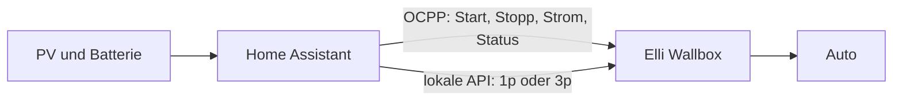

  

  
  
  

<h3 align="center">Elli Charger Connect 2 per OCPP in Home Assistant einbinden und zusätzlich lokal zwischen 1 und 3 Phasen umschalten.</h3>

Für PV-Überschussladen, das schon bei wenig Sonne startet: auf einer Phase ab etwa 1,4 kW statt erst ab etwa 4,1 kW.

---

## Das Problem

Dreiphasig lädt eine Wallbox mindestens mit 6 A, das sind rund **4,1 kW**. Scheint nur wenig Sonne, bleibt der Überschuss darunter und das Auto lädt nicht oder zieht Netzstrom. Die Elli Charger Connect 2 kann einphasig laden (ab rund **1,4 kW**), aber **OCPP bietet keine Phasenumschaltung** (`ConnectorSwitch3to1PhaseSupported: false`).

## Die Lösung

| Aufgabe | Weg | Ergebnis |
|---|---|---|
| Status, Leistung, Start/Stopp, Strombegrenzung | OCPP in Home Assistant | Entities wie `sensor.charger_*` und `switch.charger_charge_control` |
| Zählerwerte in kurzen Abständen | `ocpp.configure` | MeterValues alle paar Sekunden |
| 1p/3p umschalten | Lokale Wallbox-API (`/api/v2/...`) | Ein Shell-Script, das Home Assistant aufruft |
| Entscheidung | Automation | Startet, stoppt und wechselt die Phasen nach PV-Überschuss |

## Was du bekommst

- Funktionierende **OCPP-Anbindung** mit den wichtigsten Entities
- **Phasenumschaltung** per Script, `shell_command` und Status-Sensor
- **Beispiel-Automation** für PV-only mit Schwellwerten und Hysterese
- Debugging-Tipps und die **Stolperfallen**, über die man sonst Stunden stolpert

## Richtwerte

| Modus | 6 A | 16 A |
|---|---|---|
| 1 Phase | ca. 1,4 kW | ca. 3,7 kW |
| 3 Phasen | ca. 4,1 kW | ca. 11 kW |

Beispiel für die Regelung (anpassen, nicht blind übernehmen):

| Aktion | Bedingung |
|---|---|
| Start 1p | Batterie lädt mit mehr als 1500 W |
| Stopp | Batterie entlädt mit mehr als 100 W, Netzbezug über 500 W oder SoC unter 30 % |
| Wechsel auf 3p | Überschuss über 5000 W und SoC ab 40 % |

Das Vorzeichen der Batterieleistung ist je Wechselrichter verschieden (GoodWe: negativ = lädt). Prüfe es an deiner Anlage.

## Schnellstart

1. **OCPP-Integration** in Home Assistant hinzufügen und die Wallbox auf deine HA-Adresse konfigurieren
2. **MeterValues** setzen (`MeterValuesSampledData`, `MeterValueSampleInterval`)
3. In der Wallbox-Weboberfläche den **Servicezugang** (`technician`) einrichten. Das Servicepasswort ist nicht das WLAN-Passwort.
4. [`examples/wallbox_phase.sh`](examples/wallbox_phase.sh) nach `/config/` kopieren und ausführbar machen
5. [`examples/configuration.yaml`](examples/configuration.yaml) in deine Konfiguration übernehmen und **Home Assistant neu starten** (ein Reload reicht nicht)
6. Automation nach der Anleitung anlegen

Alle Schritte mit Befehlen und Erklärungen: **[docs/ANLEITUNG.md](docs/ANLEITUNG.md)**

## Stolperfallen in Kürze

- Die API kann beim `PUT` während des Umschaltens **HTTP 422** liefern. Danach läuft `switchInProgress`, also den Status pollen.
- **Nie während einer aktiven Ladung** umschalten. Phase anfordern und Ladestart trennen.
- `/charging/phase-type/selected` ist die Auswahl, nicht der Live-Zustand.
- Nicht alle 30 Sekunden erneut umschalten, sondern mit Hysterese und Mindestdauer arbeiten.

## Haftungsausschluss

Dies ist ein **inoffizielles Community-Projekt** ohne Verbindung zu Elli oder Volkswagen. Die lokale API ist nicht dokumentiert und kann sich mit Firmware-Updates ändern. Die Nutzung erfolgt **auf eigene Gefahr** und nur an einem Gerät, das dir gehört. Arbeiten an der Elektroinstallation gehören in die Hand einer Elektrofachkraft.

## Mitmachen

Erfahrungen mit anderen Firmware-Ständen oder Wechselrichtern sind willkommen: bitte als Issue oder Pull Request.

## Lizenz

[MIT](LICENSE)
